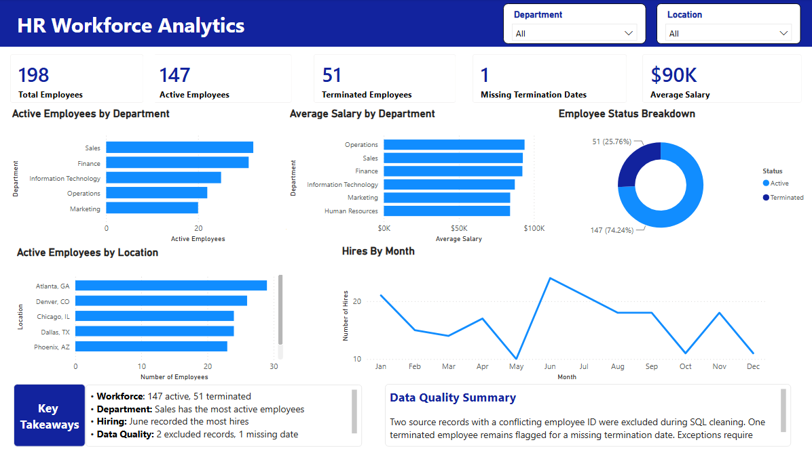

# HR Workforce Analytics | SQL & Power BI

## Overview

I built this project to get more hands-on experience using SQL and Power BI for HR reporting.

I started with a synthetic dataset of 200 employee records, cleaned inconsistencies using PostgreSQL, and built a Power BI dashboard to look at workforce trends, including headcount, compensation, hiring activity, and data quality.

The goal was to practice working through the full process, from raw data to a finished dashboard, rather than just creating visuals from an already cleaned dataset.

## Dashboard

## Tools Used

- **PostgreSQL / SQL** – Data cleaning, validation, and analysis
- **Power BI** – Dashboard development, DAX, and data visualization
- **VS Code** – SQL scripts and documentation

## What I Did

**1. Cleaned the employee data**

I imported the original dataset into PostgreSQL and used SQL to:

- Standardize department names, locations, and employment statuses
- Convert text fields into the appropriate data types
- Identify duplicate employee IDs
- Flag missing termination dates

Two records associated with a duplicate employee ID were excluded pending verification, leaving 198 records for analysis.

**2. Analyzed the workforce**

Once the data was cleaned, I wrote SQL queries to look at employee counts by status, active headcount by department and location, and average salary by department.

I also checked for missing termination dates to identify potential data quality issues.

**3. Built the Power BI dashboard**

I used the cleaned data to create an interactive dashboard with KPI cards, department and location comparisons, employee status breakdowns, and monthly hiring activity.

I also added department and location filters so users can explore different parts of the workforce.

## Key Findings

| Metric | Result |
|---|---|
| Total Employee Records | 198 |
| Active Employees | 147 |
| Terminated Employees | 51 |
| Average Salary | Approximately $90K |
| Missing Termination Dates | 1 |
| Department With Most Active Employees | Sales |
| Month With Most Hires | June |

A few things stood out during the analysis. Sales had the largest active workforce, June had the highest number of hires when grouped by calendar month, and one terminated employee was missing a termination date.

The missing termination date was a good example of why data validation matters, even when the overall dataset looks relatively clean.

## Project Files

| File | Description |
|---|---|
| `01_create_tables.sql` | Initial employee table |
| `02_create_raw_table.sql` | Raw data table |
| `03_import_census.sql` | CSV import script |
| `04_clean_employees.sql` | Data cleaning |
| `05_workforce_analysis.sql` | Workforce analysis queries |
| `employees_census_raw.csv` | Original synthetic dataset |
| `HR_Workforce_Analytics.pbix` | Power BI dashboard |
| `hr_workforce_dashboard.png` | Dashboard screenshot |

## Notes

This project uses synthetic employee data and is intended for practice and portfolio purposes.

Records with duplicate employee IDs were excluded rather than automatically corrected. In a real HR environment, these would need to be reviewed against the source system before making changes.

The dataset includes both active and terminated employees, so the total record count isn't the same as current headcount. Monthly hiring activity is grouped by calendar month across all years, not presented as a year-over-year trend.